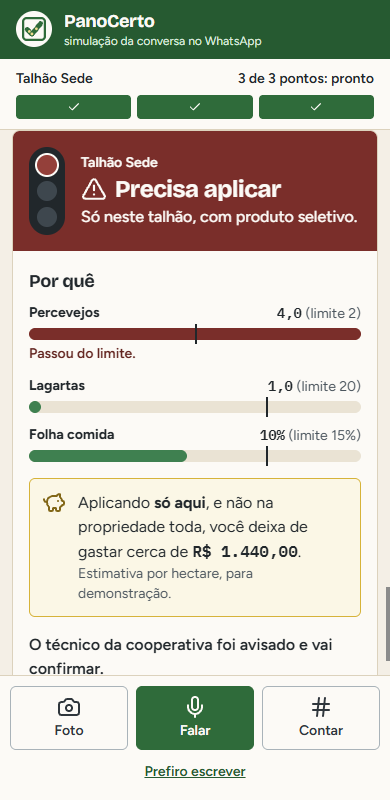
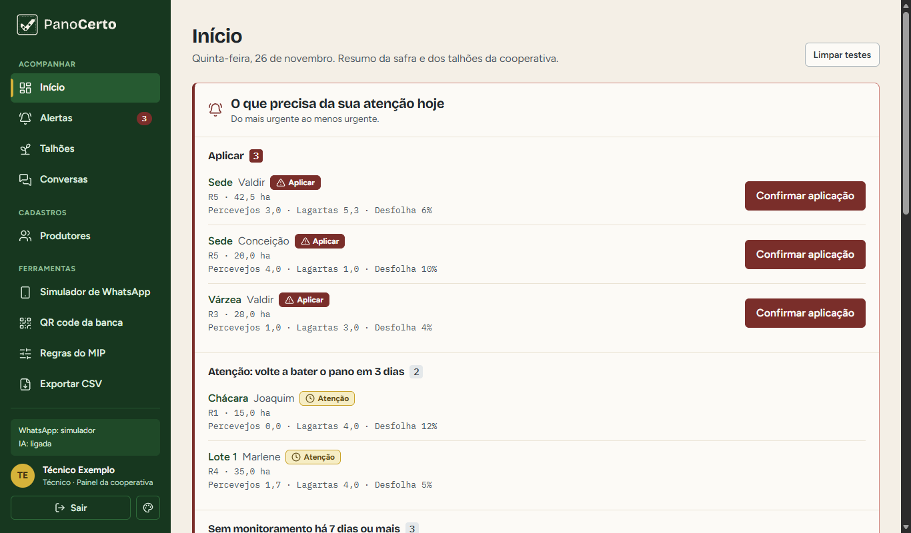

# PanoCerto

**Monitoramento de pragas da soja pelo celular: o produtor manda o pano de batida e recebe na hora se precisa aplicar inseticida.**

**Protótipo no ar:** https://panocerto.onrender.com/convite
O servidor é gratuito e dorme quando ninguém usa. No primeiro acesso, pode levar até 1 minuto para abrir.

<p align="center">
  
  &nbsp;
  
</p>

## O problema

- Muita lavoura de soja é pulverizada **por calendário**, mesmo quando a praga não chegou ao nível de dano. Isso gasta dinheiro e prejudica a lavoura e os inimigos naturais das pragas.
- O **pano de batida**, método do Manejo Integrado de Pragas (MIP), mostra quanta praga existe de verdade. Mas anotar, calcular e decidir no campo dá trabalho.
- O **técnico da cooperativa** fica sabendo tarde, quando passa na propriedade ou recebe a planilha.

## A solução

O produtor bate o pano e manda **uma foto, um áudio ou um texto** pelo celular. Em segundos, recebe a decisão: aplicar, esperar 3 dias ou voltar em 7 dias. O técnico acompanha todos os talhões num painel e confirma as aplicações com um clique.

## Como funciona

1. **Produtor:** bate o pano em 3 pontos do talhão e manda cada ponto por foto, áudio ou texto.
2. **IA:** só **lê os números**. Conta percevejos e lagartas na foto, transcreve o áudio e entende frases soltas. Quando não tem certeza, pergunta "Está certo?".
3. **Regra do MIP:** quem **decide** é uma regra fixa, em código testado. Ela compara a média dos pontos com os níveis de ação. A IA nunca decide sozinha.
4. **Técnico:** recebe o alerta no painel, confirma a aplicação com um clique, e o produtor é avisado na hora.

O resultado aparece como um semáforo, com o motivo em linguagem simples e a área que fica sem pulverizar.

<p align="center">
  
</p>

## Tecnologias

- **Backend:** Java 21, Spring Boot 3.5, Spring Security (JWT), JPA e Flyway, banco H2 ou PostgreSQL
- **Painel e tela do produtor:** React 19, TypeScript, Vite, Tailwind CSS 4, Recharts
- **IA:** OpenAI (leitura da foto, transcrição do áudio e leitura de texto livre)
- **Hospedagem:** Docker no Render

O sistema foi feito para o produtor usar o próprio WhatsApp (Cloud API da Meta), mas essa integração ainda não foi testada com a Meta. No protótipo, a banca usa uma página que imita a conversa e passa pelo mesmo fluxo do robô.

## Como rodar localmente

Pré-requisitos: JDK 21 ou mais novo e Node.js 20 ou mais novo.

```powershell
# 1. Configuração: copie o exemplo e preencha o que tiver (sem chaves, a IA funciona em modo demonstração)
copy .env.example .env

# 2. Backend (terminal 1)
cd backend
.\mvnw.cmd spring-boot:run "-Dspring-boot.run.profiles=dev"

# 3. Painel (terminal 2)
cd frontend
npm install
npm run dev
```

Abra http://localhost:5173 e entre com `tecnico@panocerto.com` e a senha `123456` (ou a definida em `SENHA_PAINEL`). O sistema já abre com dados fictícios de exemplo.

Variáveis principais do `.env` (veja todas em [`.env.example`](.env.example)):

| Variável | Para que serve |
|---|---|
| `OPENAI_API_KEY` | Liga a IA real (foto, áudio e texto). Sem ela, usa respostas de demonstração. |
| `SENHA_PAINEL` | Senha do painel do técnico. |
| `MODO_BANCA` | `true` libera a página de teste (`/testar` e `/convite`). |
| `CUSTO_APLICACAO_HA` | Custo por hectare de uma aplicação, usado na economia estimada. |

Testes: `cd backend; .\mvnw.cmd test`. O guia técnico completo, com a conexão ao WhatsApp da Meta, está em [`docs/guia-tecnico.md`](docs/guia-tecnico.md).

## Avisos importantes

- **Níveis de ação:** vêm das recomendações da **Embrapa Soja** e do **IDR-Paraná**. Eles **ainda estão em validação com agrônomo** e podem ser ajustados na tela "Regras do MIP".
- **Economia:** o protótipo não mostra valores em reais. A redução de aplicações citada no pitch vem da Embrapa Soja e do IDR-Paraná; a economia real será medida no piloto.
- **Dados:** todos os produtores, talhões e números do protótipo são fictícios.

## Equipe

**Sofia Alamini, Luiz Henrique Santetti e Pietro Catafesta**
Inovathon Agro 2026 – City Farm FAG
